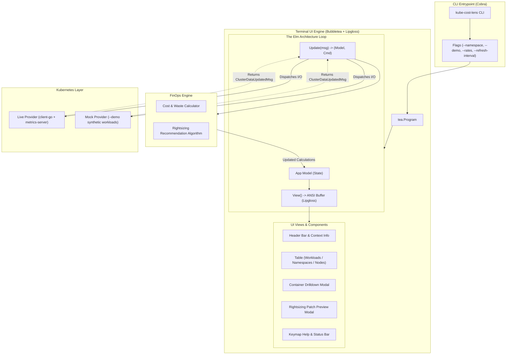

# kube-cost-lens

Interactive FinOps Terminal User Interface (TUI) for Kubernetes resource utilization, idle waste calculation, and 1-click strategic merge patch generation.


---

## Overview

Kubernetes workloads frequently suffer from significant resource over-provisioning: developers set generous CPU and memory requests to prevent OOMKills and CPU throttling, which leads to substantial financial waste on idle cloud infrastructure.

`kube-cost-lens` is a single-binary terminal application built with Go, Bubbletea, and client-go. It connects to your active Kubernetes cluster context or runs in an offline synthetic demo mode, continuously comparing provisioned requests against actual usage metrics to expose real-time financial burn rates and idle waste. With one keystroke (`p`), operators can inspect rightsizing recommendations and generate ready-to-apply strategic merge patch manifests.

---

## Architectural Principles

1. **The Elm Architecture (TEA):**
   State, updates, and rendering are decoupled using `charmbracelet/bubbletea`. State transitions are driven by explicit messages (`tea.Msg`), while views are rendered declaratively with `charmbracelet/lipgloss`.

2. **Zero-Lag Terminal Performance:**
   Terminal rendering and data retrieval are decoupled. The UI updates smoothly at terminal speed, while cluster metrics are scraped asynchronously via background commands.

3. **Pluggable FinOps Cost Engine:**
   Supports standard cloud provider rate cards (AWS, GCP, Azure, or blended average) as well as custom datacenter hardware pricing via JSON rate cards.

4. **Zero External Runtime Dependencies:**
   Compiles into a standalone static binary with no external runtimes (no Node.js, Python, or JVM required).

---

## Architecture Diagram



---

## Installation

### From Source

Ensure Go 1.22+ is installed on your workstation:

```bash
git clone https://github.com/dawidbera/kube-cost-lens.git
cd kube-cost-lens
make build
./bin/kube-cost-lens --help
```

### Direct Go Install

```bash
go install github.com/dawidbera/kube-cost-lens@latest
```

### Docker Container

```bash
docker run --rm -it ghcr.io/dawidbera/kube-cost-lens:latest --demo
```

---

## Quickstart & Usage

### 1. Offline Demo Mode

Explore the full interactive TUI with pre-configured synthetic cluster workloads without needing a live Kubernetes cluster:

```bash
./bin/kube-cost-lens --demo
```

### 2. Live Cluster Inspection

Inspect your currently active Kubernetes context (`~/.kube/config` or `KUBECONFIG`):

```bash
./bin/kube-cost-lens
```

Target a specific namespace:

```bash
./bin/kube-cost-lens -n production
```

### 3. Custom Cloud Rates

Apply a custom price card or override unit prices on the fly:

```bash
./bin/kube-cost-lens --rates assets/sample-pricing.json
./bin/kube-cost-lens --cpu-rate 0.0450 --ram-rate 0.0060
```

---

## Keyboard Navigation

| Key | Context | Action |
| :--- | :--- | :--- |
| `↑` / `k` | Table View | Navigate up one row |
| `↓` / `j` | Table View | Navigate down one row |
| `Tab` | Global | Cycle forward through views (Workloads -> Namespaces -> Nodes) |
| `Shift+Tab` | Global | Cycle backward through views |
| `1`, `2`, `3` | Global | Jump directly to Workloads, Namespaces, or Nodes view |
| `Enter` | Workload Table | Open container drilldown & sizing recommendations modal |
| `p` | Workload Table | Open 1-click strategic merge patch preview modal |
| `/` | Table View | Open live search filter prompt |
| `Esc` | Modal / Filter | Close active modal dialog or clear active search filter |
| `c` | Patch Modal | Copy generated patch YAML to system clipboard |
| `w` | Patch Modal | Export patch YAML to disk (`./patch-<workload>.yaml`) |
| `r` | Global | Force immediate background cluster refresh |
| `?` | Global | Toggle keyboard shortcut help overlay |
| `q` / `Ctrl+C` | Global | Cleanly restore terminal and exit |

---

## FinOps Calculation Formulas

### Pricing Assumptions

Default rates are derived from blended multi-cloud averages (AWS m6i, GCP e2, Azure Dsv5):
- **CPU Unit Rate:** `$0.0416` per vCPU-hour (~`$30.37` / vCPU-month)
- **Memory Unit Rate:** `$0.0055` per GB-hour (~`$4.02` / GB-month)
- **Accounting Month:** `730.0` hours

---

## Sample Patch Manifest

When pressing `p` on a selected workload (e.g. `default/payment-api`), `kube-cost-lens` generates an exact Kubernetes strategic merge patch:

```yaml
# Generated by kube-cost-lens for deployment: default/payment-api
# Estimated Monthly Savings: $118.20 (-83.1%)
# Apply with: kubectl patch deployment payment-api -n default --patch-file <this-file>
spec:
  template:
    spec:
      containers:
        - name: payment-api
          resources:
            requests:
              cpu: 600m
              memory: 1536Mi
            limits:
              cpu: 900m
              memory: 2304Mi
```

Apply directly with `kubectl`:

```bash
kubectl patch deployment payment-api -n default --patch-file patch-payment-api.yaml
```

---

## Technical Lessons Learned (Gotchas)

1. **Bubbles Table Viewport Column Count Synchronization:**
   When switching between views (e.g., Workloads table with 8 columns vs. Namespaces table with 7 columns), invoking `Table.SetColumns()` triggers an immediate internal call to `UpdateViewport()`. If existing rows have more columns than the new column slice, a runtime panic occurs (`index out of range`). Clearing existing rows (`Table.SetRows([]table.Row{})`) *before* invoking `SetColumns()` guarantees safe transitions.

2. **Cobra Subcommand Test Isolation:**
   In Cobra, executing a subcommand via `subcmd.Execute()` internally executes the root command with ambient `os.Args`. In automated unit tests, this can cause the root command to capture test harness flags and block waiting for TUI terminal input. Testing subcommands should always configure `rootCmd.SetArgs(...)` explicitly.

3. **Memory Quantity Normalization:**
   Kubernetes resource strings for memory use binary power prefixes (`Mi`, `Gi`). Formatting intermediate numbers with decimal abbreviations (such as `1.5G`) can trigger decimal conversion ambiguities in older Kubernetes API server versions. Retaining integer `Mi` values (e.g., `1536Mi`) avoids parse discrepancies.

---

## Troubleshooting

### Terminal Output Distortion or Overlapping Lines
- **Symptom:** Terminal contents wrap unpredictably or leave residual characters after exiting modals.
- **Solution:** `kube-cost-lens` requires an ANSI-compliant terminal with a minimum dimension of 80x24 characters. Enlarge your terminal window or press `Ctrl+L` / `r` to trigger a screen redraw.

### Metrics Server Unreachable in Live Mode
- **Symptom:** Live cluster connects, but container usage figures show zero or estimated baselines.
- **Solution:** Verify that `metrics-server` is deployed and healthy in your cluster by running `kubectl top pods -A`. If metrics-server is absent or RBAC permissions are missing, `kube-cost-lens` gracefully defaults to safe baseline estimates without crashing.

